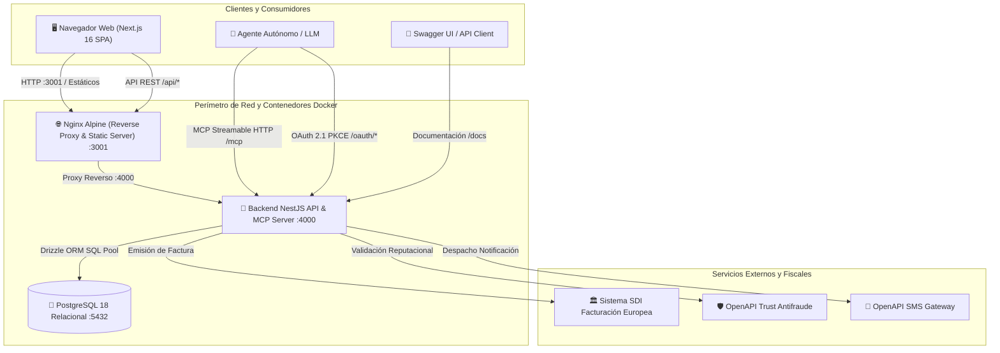
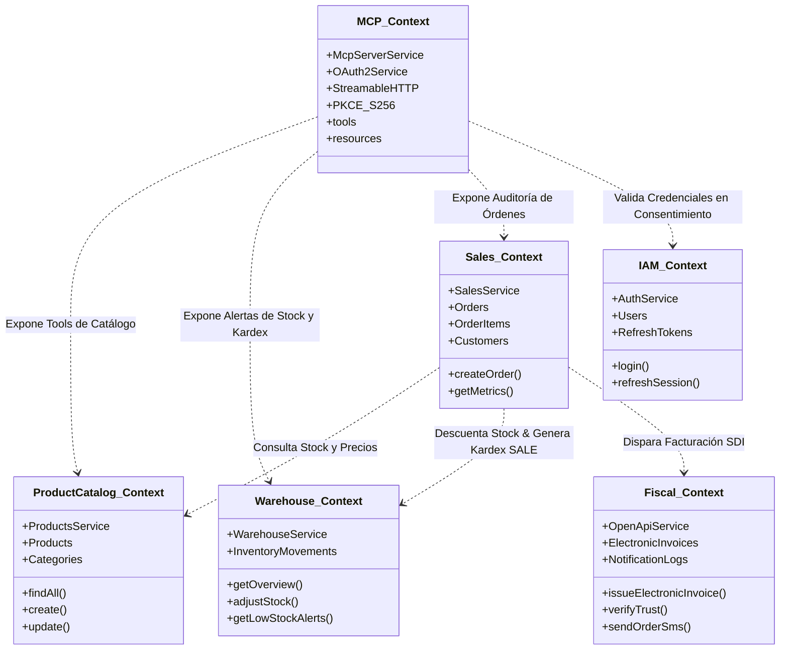
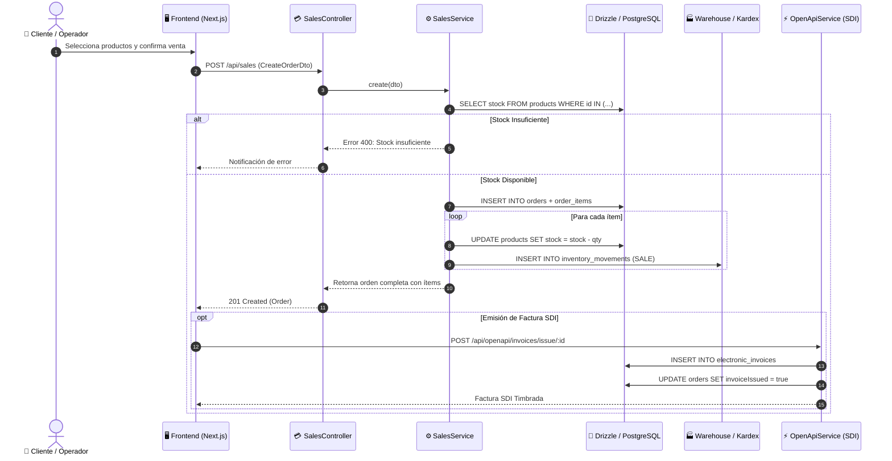
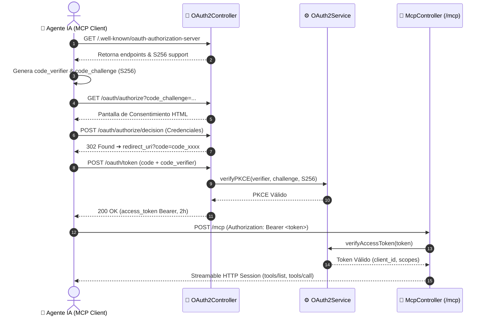
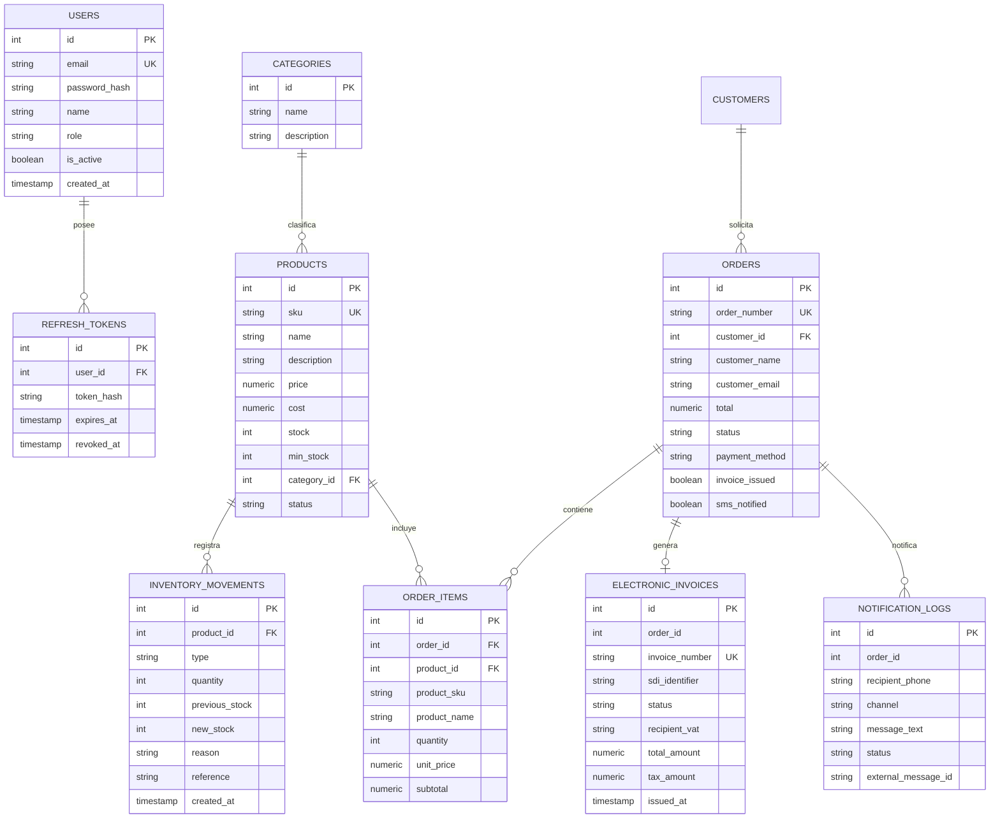

# ARCHITECTURE.MD: Arquitectura de Dominio, DDD y MCP NexusSales

Este documento detalla la arquitectura de software completa de **NexusSales Ecommerce**, integrando los principios de **Domain-Driven Design (DDD)**, la especificación de diseño **C4**, el servidor **Model Context Protocol (MCP)** bajo la era moderna `2026-07-28` con **OAuth 2.1 + PKCE**, y la infraestructura contenerizada con **Docker Multi-Stage**.

---

## 1. Visión General de la Arquitectura

NexusSales es una plataforma de comercio electrónico modular de alto rendimiento compuesta por:
- **Capa de Presentación Web**: Aplicación Next.js 16 con Tailwind CSS v4, exportación estática optimizada y servida por Nginx Alpine.
- **Capa de Dominio y Servicios (Backend)**: Microservicios unificados en NestJS organizados en Bounded Contexts desacoplados.
- **Capa de Persistencia**: PostgreSQL 18 con mapeo relacional tipo-seguro mediante Drizzle ORM y migraciones SQL inmutables.
- **Capa de Integración de Agentes (MCP Gateway)**: Servidor Streamable HTTP para Model Context Protocol protegido mediante OAuth 2.1 con reto PKCE S256.
- **Capa Fiscal y de Confianza (OpenAPI Suite)**: Integración con los estándares europeos SDI de facturación electrónica, validación antifraude Trust y mensajería transaccional SMS.

---

## 2. Modelo C4 (Contexto, Contenedores y Componentes)

### 2.1 Nivel 1: Contexto del Sistema
El sistema proporciona capacidades completas de comercialización digital para administradores humanos y expone herramientas estructuradas para que agentes de inteligencia artificial auditen inventarios, procesen ventas y verifiquen el cumplimiento tributario.

### 2.2 Nivel 2: Contenedores
1. **`ecommerce_frontend`**: Multi-stage build con Node.js 26 Alpine para compilación estática y Nginx Alpine para servir la interfaz web con compresión Gzip, enrutamiento SPA y proxy inverso hacia el backend en `:4000`.
2. **`ecommerce_backend`**: Contenedor Node.js 26 Alpine con subproceso `tini` que ejecuta la API NestJS, controladores REST optimizados y el servidor MCP.
3. **`ecommerce_postgres`**: Base de datos relacional PostgreSQL 18 con volumen persistente (`db_postgres_data`).

### 2.3 Nivel 3: Componentes del Backend
El backend se organiza en módulos de NestJS que encapsulan cada Agregado del Dominio:
- `DbModule`: Conexión de pool PostgreSQL 18 y servicio Drizzle ORM.
- `AuthModule`: Autenticación JWT y rotación de Refresh Tokens.
- `ProductsModule`: Catálogo de productos y categorías con filtrado compuesto indexado.
- `SalesModule`: Agregado de órdenes, ventas e ítems de pedido con consultas batch optimizadas contra N+1.
- `WarehouseModule`: Control de stock, inventario y movimientos Kardex inmutables.
- `OpenApiModule`: Facturación SDI, verificación de Trust y SMS.
- `McpModule`: Servidor MCP (`nexus-ecommerce-mcp`) y servidor de autorización OAuth 2.1 con PKCE.

### 2.4 Nivel 3: Componentes del Frontend (Next.js 16.4 / React 19.3)
La interfaz de usuario implementa una arquitectura modular desacoplada:
- **`Header`**: Barra de navegación superior con alternador de tema oscuro/claro y control móvil.
- **`Sidebar`**: Navegación lateral reactiva con insignias numéricas y estado de autenticación.
- **`DashboardTab`**: Tarjetas KPI en tiempo real, gráficos vectoriales SVG con curvas Bézier de ventas/capitalización y órdenes recientes.
- **`ProductsTab` & `ProductModal`**: Catálogo interactivo con filtrado dinámico por SKU/categoría y gestión CRUD.
- **`SalesTab` & `NewSaleModal`**: Registro y auditoría de ventas, gestión de estados ("En Proceso" / "Completado") y proyección semanal.
- **`WarehouseTab` & `StockAdjustModal`**: Monitoreo de stock crítico, fallback automático a últimas salidas y auditoría Kardex.
- **`OpenApiTab` & `InvoicePdfModal`**: Módulo fiscal para emisión SDI, validación antifraude y notificaciones SMS.

---

## 3. Arquitectura Guiada por el Dominio (Domain-Driven Design)

### 3.1 Bounded Contexts y Context Mapping

### 3.2 Agregados y Reglas de Negocio Tácticas

#### Agregado 1: Identity & Access Management (IAM)
- **Raíz de Agregado**: `User`
- **Entidades Vinculadas**: `RefreshToken`
- **Invariantes y Reglas**:
  - Toda contraseña se almacena cifrada mediante algoritmo `bcrypt` con factor de coste 10.
  - Los Access Tokens tienen expiración estricta de 15 minutos.
  - Los Refresh Tokens se firman con HMAC-SHA256, se registran con `expiresAt` (7 días) y se invalidan irrevocablemente (`revokedAt = NOW()`) ante cada rotación o logout.

#### Agregado 2: Product Catalog
- **Raíz de Agregado**: `Product`
- **Entidades Vinculadas**: `Category`
- **Invariantes y Reglas**:
  - El código `SKU` debe ser único en todo el catálogo.
  - Al crearse un producto con `stock > 0`, el sistema emite automáticamente un movimiento inicial de almacén de tipo `IN`.
  - Los estados permitidos son `active`, `inactive` y `out_of_stock`.

#### Agregado 3: Sales & Order Fulfillment
- **Raíz de Agregado**: `Order`
- **Entidades Vinculadas**: `OrderItem`, `Customer`
- **Invariantes y Reglas**:
  - Antes de persistir una venta, se verifica en tiempo real que cada ítem disponga de existencia suficiente (`prod.stock >= item.quantity`).
  - La creación de la venta es atómica: descuenta el stock de los productos afectados y genera los correspondientes registros de Kardex con tipo `SALE`.
  - El total de la orden se calcula automáticamente a partir de los precios unitarios vigentes de catálogo.

#### Agregado 4: Warehouse & Inventory (Kardex)
- **Raíz de Agregado**: `InventoryMovement`
- **Value Objects**: `WarehouseOverview`
- **Invariantes y Reglas**:
  - Todo movimiento de inventario es inmutable (solo lectura y adición cronológica).
  - En movimientos de salida (`OUT`), el sistema valida estrictamente que la cantidad a retirar no supere el stock existente para impedir saldos negativos.
  - Los tipos de movimiento soportados son:
    - `IN`: Entrada manual de mercadería.
    - `OUT`: Salida manual / descarte / merma.
    - `SALE`: Descuento automático generado por una venta en el ecommerce.
    - `RETURN`: Devolución de cliente o reposición a stock.

#### Agregado 5: Fiscal & Integración OpenAPI
- **Raíz de Agregado**: `ElectronicInvoice`
- **Entidades Vinculadas**: `NotificationLog`
- **Invariantes y Reglas**:
  - El número de factura sigue el formato fiscal estandarizado `FAC-YYYY-XXXXX`.
  - Se vincula al código único de timbrado SDI (`sdiIdentifier`) generado en el microservicio.
  - La tasa de IVA se calcula automáticamente (22% / 18%) desglosando el subtotal y el importe del impuesto.
  - Genera y expone la plantilla HTML interactiva imprimible y convertible a PDF oficial.

#### Agregado 6: Agentic MCP Gateway & OAuth 2.1
- **Raíz de Agregado**: `OAuthClient` / `AuthorizationCodeGrant`
- **Invariantes y Reglas**:
  - Obligatoriedad del método de reto PKCE `S256` en el intercambio de códigos de autorización.
  - Los códigos de autorización expiran tras 10 minutos y son de uso único (*one-time use*).
  - Servidor MCP opera bajo el protocolo moderno `2026-07-28` en modo `STREAMABLE-HTTP`, garantizando compatibilidad con clientes legacy.

---

## 4. Diagramas de Secuencia Transaccional

### 4.1 Ciclo de Vida de una Venta con Descuento de Kardex y Facturación SDI

### 4.2 Autorización OAuth 2.1 PKCE y Flujo de Stream MCP

---

## 5. Esquema de Base de Datos y Entidades

---

## 6. Estrategia de Contenerización y Despliegue

La solución se empaqueta mediante **Docker Multi-Stage**:

1. **Backend (`backend/Dockerfile`)**:
   - `builder`: Imagen `node:26-alpine`. Compila TypeScript con NestJS eliminando fuentes no productivas.
   - `runner`: Imagen `node:26-alpine` con el init manager `tini` para evitar procesos zombie en contenedores Node.js, ejecuta como usuario de bajo privilegio `node` en puerto 4000.
2. **Frontend (`frontend/Dockerfile`)**:
   - `builder`: Imagen `node:26-alpine`. Ejecuta `npm run build` con Next.js 16.4 (Turbopack) exportando el código estático a `/app/out`, con soporte para el build argument `NEXT_PUBLIC_API_URL`.
   - `runner`: Imagen Nginx Alpine de tamaño ultra reducido (~25MB), configurada con compresión Gzip, enrutamiento SPA y proxy inverso hacia los endpoints del backend en `:4000`.
3. **Orquestador (`docker-compose.yml`)**:
   - Coordina los 3 contenedores (`ecommerce_postgres` bajo `postgres:18-alpine`, `ecommerce_backend` en `node:26-alpine`, `ecommerce_frontend` con Nginx y `node:26-alpine`) con directivas de construcción local (`build`), comprobaciones de salud (`healthcheck` en Postgres) y volúmenes persistentes (`db_postgres_data`) para salvaguardar los datos relacionales de PostgreSQL 18.
